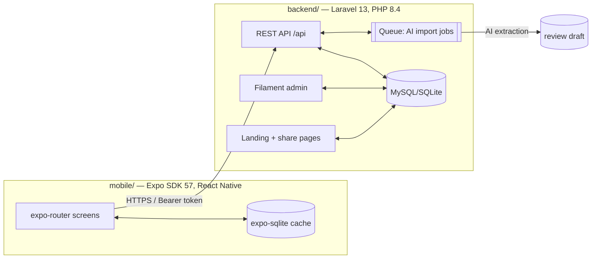

# RecipeReal

> **Honest cook times for real kitchens.** Recipes say “25 minutes” — dinner says otherwise. RecipeReal measures what recipes *really* take with a stopwatch in guided Cook Mode, then calibrates every estimate to *your* pace.

[](https://github.com/SoftLand-Tech/recipe-real/actions/workflows/backend.yml)
[](https://github.com/SoftLand-Tech/recipe-real/actions/workflows/mobile.yml)
[](LICENSE)
[](backend/)
[](mobile/)
[](backend/)
[](mobile/)
[](mobile/app.config.js)

**Live:** [recipe-real.softland.tech](https://recipe-real.softland.tech) &nbsp;·&nbsp; **APK:** [recipe-real.softland.tech/download](https://recipe-real.softland.tech/download) &nbsp;·&nbsp; **Privacy:** [/privacy](https://recipe-real.softland.tech/privacy)


---

## Why RecipeReal?

Published recipe times systematically omit prep, cleanup, and real-life interruptions. A recipe that claims 25 minutes routinely takes 60–90 in a real kitchen.

RecipeReal fixes this with a **measurement loop**:

```
Recipe → 3-skill estimate → Cook Mode (stopwatch) → Log → Calibrate to YOU
```

The “aha” moment: *“I knew this would take 52 minutes before I started chopping — and it actually took 49.”*

| Claim | Reality |
|---|---|
| “25 min” (publisher) | **“Really takes 74 min”** (measured, teal) |
| One generic number | Calibrated to *your* onion-dice speed |
| Test-kitchen fantasy | Includes cleanup + your interruption level |

## Features

| Area | What’s in 1.1.0 |
|---|---|
| **Honest times** | Claimed vs. measured (“Really takes”) on every recipe; Reality Index leaderboard of most under/over-estimated recipes |
| **Guided Cook Mode** | Full-screen step-by-step stopwatch, step alarms, pause/resume, per-step timing — works with screen locked |
| **Calibrated to you** | Pace calibration learns your speed after a few cooks; serving scaler; ingredient checklist + shopping list |
| **20,000+ recipes** | Offline-first library (SQLite on device); categories, search with pagination, fridge/multi-ingredient filter |
| **EN/AR + RTL** | Full bilingual app with complete right-to-left support |
| **Community** | Posts (“tries”), likes, comments, follows, public notes, user recipes, share pages (`/r`, `/p`, `/u`) with App Links |
| **Halal-first** | Explicit pork & alcohol screening on community content, user recipes, and AI imports (`recipereal:audit-halal-library`) |
| **Recipe import** | URL / image / video → queued AI extraction → private review draft → owner publishes (never auto-public) |
| **Offline** | Library downloads to the phone; browse + cook with no signal |
| **Free** | Free to download and use. Premium ($5.99/mo) is planned — checkout not live in this build |

## Architecture



**Design language:** warm kitchen-table — cream `#FAF6EF`, ink `#26211B`, action orange `#F26B1D`, timing teal `#287C78` (reserved for measured time only). See [DESIGN.md](DESIGN.md).

## Monorepo layout

```
recipe-real/
├── backend/          # Laravel 13 API + landing + Filament admin
│   ├── app/          # Models, controllers, jobs, services
│   ├── routes/       # api.php (~40 endpoints) · web.php (landing, /r, /p, /u, /download)
│   ├── database/     # Migrations + seeders (20,089-recipe library pipeline)
│   ├── resources/    # Blade landing, share pages, privacy / account-delete pages
│   └── tests/        # PHPUnit feature + unit suite
├── mobile/           # Expo SDK 57 (React Native + TypeScript) Android client
│   └── src/          # expo-router screens, offline SQLite cache, API client, i18n
├── store/            # Third-party Android store submission kit (APKPure, Galaxy, Huawei…)
│   ├── listing-en.md · listing-ar.md   # paste-ready copy (claim-identical)
│   └── assets/       # icon-512 + feature graphic (regenerable via script)
├── docs/             # Deploy, launch, auth, beta + store-release runbooks
├── remotion-ads/     # Promo-video generator (Remotion, side tooling)
├── deploy.sh         # One-command VPS deploy (pull → migrate → build → cache → restart)
├── PRODUCT.md        # Product truth (facts that must stay true on every surface)
├── PRD.md · MVP.md · DESIGN.md         # Spec, scope, design system
└── haram-filter.json # Halal screening rules
```

## Quickstart

### Backend (Laravel)

```bash
cd backend
cp .env.example .env          # fill DB_*, RECIPE_AI_*, Google client
composer install
php artisan key:generate
php artisan migrate --force
npm install && npm run build  # landing + panel assets
php artisan serve              # http://localhost:8000
```

Run the queue worker (required for AI recipe imports):

```bash
php artisan queue:work --tries=2 --timeout=660
```

Useful commands:

```bash
php artisan test                                  # full suite
php artisan recipereal:audit-halal-library        # scrub non-halal community content
php artisan recipereal:backfill-reality           # rebuild claim-vs-reality stats
```

Full backend docs (env matrix, AI providers, deployment checklist): [backend/README.md](backend/README.md)

### Mobile (Expo)

```bash
cd mobile
npm install
npx expo start        # press `a` for Android, scan QR for Expo Go
```

Point local dev at a LAN backend (default is production):

```bash
RECIPEREAL_API_BASE_URL=http://10.0.2.2:8000 npx expo start
```

EAS builds inject the production URL automatically via `eas.json` — never hand-edit config. Full client docs: [mobile/README.md](mobile/README.md)

## API overview

Base URL `https://recipe-real.softland.tech/api` · Auth: Google ID-token → Sanctum Bearer · Throttled per route group.

| Method | Endpoint | Notes |
|---|---|---|
| POST | `/auth/google`, `/auth/google/code` | Sign-in (implicit + PKCE code exchange) |
| GET | `/recipes`, `/recipes/search`, `/recipes/seed` | Browse, debounced search, offline seed |
| GET | `/recipes/{id}`, `/recipes/categories` | Detail + taxonomy |
| GET | `/home`, `/reality` | Home rails · Reality leaderboard (cached 15 min) |
| POST | `/cook-sessions`, `/recipes/{id}/quick-time` | Stopwatch log · one-tap “actually took N min” |
| GET | `/pace-calibrations` | Your personal pace overlay |
| POST/PATCH/DELETE | `/recipes` (user recipes) | Owner-scoped writes |
| POST | `/recipe-imports`, GET `/recipe-imports/{id}` | AI import → poll until review-ready |
| GET/POST | `/posts`, `/posts/{id}/comments` | Community feed (public reads) |
| GET | `/users/{id}/profile`, `/users/me/recipes` | Public profile · my recipes |
| POST/DELETE | `/follows`, `/likes`, `/blocks`, `/reports` | Social graph + moderation |
| POST | `/events`, `/installs` | Self-hosted analytics heartbeat |
| DELETE | `/account` | Account deletion (store-policy compliant) |

Share pages (deep-link targets, Android App Links verified): `/r/{id}` recipe · `/p/{id}` post · `/u/{id}` profile.

## Releases & distribution

- **Primary channel:** direct APK — [/download](https://recipe-real.softland.tech/download) streams the newest signed build from the admin panel’s *App releases* table. `deploy.sh` is the one-command VPS deploy.
- **Third-party stores:** [store/](store/) is the submission kit for APKPure, Uptodown, Samsung Galaxy Store, Xiaomi GetApps, Huawei AppGallery, Amazon Appstore. Google Play is intentionally out of scope.
- **Version:** `1.1.0` (`mobile/app.config.js`, package `com.recipereal.app`, min Android 7.0 / API 24).
- **Screenshots rule:** every store screenshot must be captured from the running 1.1.0 app (`store/screenshots/capture-screenshots.sh`) — never mockups.

## Roadmap

- [ ] Stripe Premium checkout ($5.99/mo) — gating + webhooks
- [ ] Skill-level stratified timing (novice / intermediate / expert distributions)
- [ ] Interruption-penalty modeling (high/med/low → passive-step multiplier)
- [ ] Timing karma (streaks, badges for accurate reporters)
- [ ] Grocery / meal-kit handoff

Ideas live in [docs/community-roadmap.md](docs/community-roadmap.md) · launch plan in [docs/launch.md](docs/launch.md) · beta plan in [docs/beta.md](docs/beta.md).

## Contributing

Small, focused PRs welcome. Please read [CONTRIBUTING.md](CONTRIBUTING.md) first — it covers setup, branch naming, commit style, the orange/teal design rules, and the “no invented numbers” copy rule. By participating you agree to the [Code of Conduct](CODE_OF_CONDUCT.md).

## Security

Found a vulnerability? **Do not open a public issue** — see [SECURITY.md](SECURITY.md) for how to report it privately.

## License

MIT — see [LICENSE](LICENSE). © SoftLand-Tech.

---

<p align="center">
  <br>
  <sub>Built with honesty by <a href="https://github.com/SoftLand-Tech">SoftLand-Tech</a> · Cairo, Egypt</sub>
</p>
